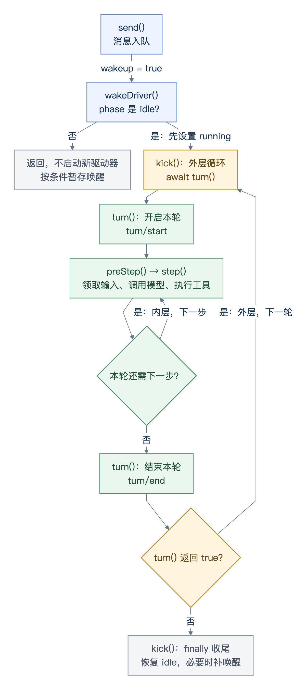

# 源码精读2：一条消息如何驱动 Agent 执行

[上一章](dsh-startup-revised-20261016.md)讲应用启动。本章跟踪一条消息：入队、唤醒 Agent、调用模型、执行工具，直到轮次结束。源码基准为 2026-10-29，主文件是 [agent-loop/src/agent.ts](../packages/core/agent-loop/src/agent.ts)。

本章要解决的设计问题是：用户在执行过程中继续发消息、修改要求或取消时，应用怎样协调这些输入与正在进行的工作？读完应能确定自己应用的输入排队、执行互斥、取消和完成判定规则。

阅读时沿“读取 README 并总结”这个例子追踪调用链。源码细节与 Q&A 可按需展开，最后的设计决策表将机制对应到应用需要作出的选择；工具权限、业务操作恢复和上下文策略在[后续章节](dsh-source-reading-outline-20261029.md)分别展开。

## 1. Session、Agent、Turn、Step

| 概念 | 含义 |
| --- | --- |
| `Session` | 会话事件记录；模型历史由这些事件派生。落盘由持久化组件负责。 |
| `Agent` | 驱动一个会话的运行对象，当前默认实现为 `ReactLoopAgent`，持有 Inbox、执行状态和取消控制。 |
| `Inbox` | 已接收、尚未领取的输入，分为 `next-turn` 和 `next-step`。 |
| `Turn` | 一个轮次，从 `turn/start` 到 `turn/end`，可以包含多个 Step。 |
| `Step` | 一个步骤，处理模型响应及其中的工具调用。请求重试仍留在当前 Step。 |

例如“读取 README 并总结”：第一步调用模型决定读文件，第二步让模型根据文件内容总结。这是一个 Turn、两个 Step。被拒绝或首批输入为空的 Turn 也可能没有 Step。

Session 保存可重建的会话事实，Agent 保存 Promise、取消控制器等运行状态。这样恢复会话时，可以读取原来的历史，再建立新的执行状态；无需把上一次进程里的异步任务也“恢复”出来。

Turn 表示执行循环中的一个轮次。一个业务目标可能需要多个轮次；`turn/end` 的 `completed` 说明该轮按循环规则结束，业务目标是否达成还要核对实际结果。这一区别会影响接口状态、界面反馈和任务评测。

### 1.1 这里的 Agent 具体是什么对象？

**这里的 Agent，是服务端内存中驱动一个 Session 执行的 `ReactLoopAgent` 实例。** 它接收输入、安排 Turn 和 Step、调用 LLM 服务、调度工具，并把执行结果记录到 Session。后文“`phase` 是 Agent 内部的活动状态对象”展开后就是：**每个 `ReactLoopAgent` 实例，都有自己的 `private phase: Phase` 成员。**

<details>
<summary>源码定位：Agent 接口、具体实现和创建工厂</summary>

源码中有三个相近的名字，分别承担不同职责：

| 名字 | 源码中的角色 |
| --- | --- |
| [`Agent`](../packages/core/agent/src/types.ts#L15) | 对外的 TypeScript 接口。基础定义声明 `id`，[运行时声明合并](../packages/core/agent/src/runtime-types.ts#L163)再补充 `session`、`inbox`、`status`、`followup()`、`cancel()` 等成员，供调用方使用。 |
| [`ReactLoopAgent`](../packages/core/agent-loop/src/agent.ts#L98) | `implements Agent` 的具体类。本章的 `wakeDriver()`、`kick()`、`turn()`、`step()` 都是这个类的实例方法；方法里的 `this` 指向当前实例。 |
| [`AgentLoop`](../packages/core/agent-loop/src/index.ts#L341) | 注册为 `ctx.agentLoop` 的 Cordis 服务，实现 `AgentFactory`，负责创建和管理 `ReactLoopAgent` 的生命周期。 |

例如，通过 [`ctx.agents.create()`](../packages/core/agent/src/index.ts#L393) 创建时，`AgentRegistry` 会委托已注册的工厂。默认工厂 `AgentLoop` 准备 Session，并最终构造：

```typescript
new ReactLoopAgent(loopCtx, id, options, session)
```

这行代码位于[工厂的生命周期管理逻辑](../packages/core/agent-loop/src/index.ts#L604)中。调用方在初始化和发布完成后得到 `AgentHandle`，通过其中的 `agent` 访问这个实例。实例的 `id` 使用 `SessionId`，`session` 引用它所驱动的会话；构造函数还建立该实例的 Inbox、专属上下文和初始 `idle` 状态。

</details>

LLM 则负责一次模型请求的生成：`ReactLoopAgent` 根据历史、提示词和工具声明构造请求，再[调用模型流](../packages/core/agent-loop/src/agent.ts#L453)。所以一次模型请求对应循环中的一次调用，Agent 实例则可以在自己的生命周期内连续处理多个 Step、多个 Turn。

例如，同一个实例处理第 1 轮后回到 `idle`，收到下一条 `followup` 后继续处理第 2 轮，更新的是同一个 `this.phase`。另一个会话的 Agent 有自己的 `phase` 和 Inbox；本章的启动判断协调的是当前实例的活动。

## 2. 消息怎样进入 Inbox

Web 消息经过 [ApiSessionController.prompt](../packages/api/session-controller/src/index.ts#L462)，交给 [SessionCommandController.prompt](../packages/api/session-controller/src/commands.ts#L319)。命令层找到或恢复 Agent，处理附件，把内容包装为 `UserMessage`，再调用：

```typescript
if (request.mode === 'steer') agent.steer(message)
else agent.followup(message)
```

返回 `{ accepted: true }` 表示接纳消息，执行结果要等后续轮次。

### followup、steer、inject

三个方法都调用 [send](../packages/core/agent-loop/src/agent.ts#L154)，区别是目标队列和是否请求唤醒：

| 方法 | 队列 | 唤醒 | 用途 |
| --- | --- | --- | --- |
| `followup` | `next-turn` | 是 | 排到下一轮处理。 |
| `steer` | `next-step` | 是 | 在后续步骤加入要求；空闲时也启动一轮。 |
| `inject` | `next-step` | 否 | 注入上下文，空闲时只排队。 |

`steer` 和 `inject` 都接收 `UserMessage`，源码不按文字区分“指令”和“背景资料”。它们调用 `send` 时只差最后一个参数：

```typescript
steer(input: UserMessage): void {
  this.send(input, 'next-step', true)
}

inject(input: UserMessage): void {
  this.send(input, 'next-step', false)
}
```

**空闲时，steer 会启动执行，inject 不会。** 例如先 `inject` 项目背景，再 `followup` 一个问题，第一步会一起领取背景和问题。

**运行中，两者都能进入后续步骤。** 如果结束检查时 `next-step` 仍有输入，即使模型没有工具调用，当前轮次也会继续。它们不会打断已经发出的请求，领取时机已过的输入留到后续步骤。

入队和领取都记录为 `agent/inbox/spliced`。消息经 `preStep` 接纳后，才会在请求准备完成时追加为 `user/message`；入队本身不表示已经交给模型。

## 3. 谁唤醒 Agent，为什么有两层循环

两层循环分别是：

| 循环 | 在哪里 | 处理什么 | 何时重复 |
| --- | --- | --- | --- |
| 外层：轮次循环 | `kick()` 的 `while (await this.turn())` | 依次处理多个 Turn。 | 一轮正常结束后仍有排队输入，`turn()` 返回 `true`。 |
| 内层：步骤循环 | `turn()` 内的 `while (true)` | 在同一个 Turn 中执行 `preStep()`、`step()`。 | 工具结果还需模型处理，或 `next-step` 有补充输入。 |

**分成两层，是因为“当前请求还要继续”和“开始处理下一个请求”是两件事。** 例如 A 要求读取 README 并总结，读文件和根据结果总结是同一轮的两个 Step，由内层循环完成。此时 B 通过 `followup` 排队，要等 A 的 Turn 结束，再由外层循环开启下一轮处理。

`wakeDriver()` 负责启动 `kick()`，本身不是第三层循环。图中两个回箭头分别表示下一步和下一轮。



[Mermaid 源码](figures/dsh-agent-turn-flow.mmd)

### 3.1 wakeDriver：空闲时启动 kick

`phase` 是[当前 `ReactLoopAgent` 实例](#11-这里的-agent-具体是什么对象)的私有状态对象，记录“当前在做什么”和这项活动需要的数据。`Phase` 是它的 TypeScript 类型，`this.phase` 是当前值，`this.phase.kind` 是状态标记。

| `phase.kind` | 含义 | 对外的 `status` |
| --- | --- | --- |
| `idle` | 当前没有驱动任务或维护操作。 | `idle` |
| `running` | 正在执行轮次，包括等待模型、工具或取消收尾。 | `running` |
| `maintenance` | 维护操作占用 Agent，暂不执行模型轮次。 | `idle` |

<details>
<summary>源码细读：phase 的字段与类型</summary>

例如，下面的状态表示第 2 轮正在执行第 1 步，还没有待补的唤醒请求：

```typescript
const phase: Phase = {
  kind: 'running',
  turn: 2,
  step: 1,
  abort: new AbortController(),
  wakeRequested: false,
}
```

`abort` 用来传递取消，`wakeRequested` 记录收尾后需要补一次唤醒。空闲态没有当前 `turn`、`step` 和 `abort`，只保存上一轮编号 `lastTurn`。[Phase 类型](../packages/core/agent-loop/src/agent.ts#L42)用 `kind` 区分这些字段，TypeScript 因而可以在非空闲分支直接访问取消控制器。

</details>

**为什么需要这份内部状态？** 对外的 `status` 只提供 `idle`、`running` 两种值，但维护操作虽然不跑模型，仍占用 Agent。如果启动逻辑只看 `status === 'idle'`，就会把维护期间误判为可以启动。`wakeDriver()` 必须根据更细的 `phase` 决定：

| 情况 | 处理 |
| --- | --- |
| `idle` | 设置 `running`，启动 `kick()`。 |
| 正常 `running` | 不重复启动，已有驱动器继续处理输入。 |
| `maintenance`，或投递时旧活动已取消 | 未进入销毁时，记下 `wakeRequested`，等活动收尾。 |
| 活动取消原因为 `disposed` | 不记录待补唤醒。 |

[启动条件](../packages/core/agent-loop/src/agent.ts#L214)是 **`this.phase.kind === 'idle'`**。构造函数设置初始空闲态，`wakeDriver()`、`runMaintenance()` 通过 `setPhase()` 切换活动，收尾时恢复 `idle`。取消请求通过 `abort` 记录；活动停稳之前，`phase` 仍保留 `running` 或 `maintenance`，不会立即变成空闲。

启动前，`wakeDriver()` 建立取消控制器和 `activityDone` Promise，保留上一轮编号、清零步骤计数，并同步设为 `running`，因此连续投递不会启动两份驱动任务。随后在当前 Agent 的发起者上下文中调用 `kick()`。

`wakeAfterAbort` 是 `send()` 在入队前记录的“旧活动是否已取消”。这类唤醒输入转入 `next-turn`，等待旧活动结束。`kick()` 或 `runMaintenance()` 收尾时，只有 `wakeRequested` 和 `inbox.hasPending` 同时成立才补一次唤醒；输入已移除就不再启动。

`inbox.hasPending` 是补唤醒的条件，不是空闲启动分支的条件。已发生的空闲唤醒仍可开启轮次；若首次接纳输入为空，该轮不执行 Step。

### 3.2 kick：连续处理轮次，退出时收尾

[kick](../packages/core/agent-loop/src/agent.ts#L252) 的循环是：

```typescript
while (await this.turn()) {}
```

工作在条件表达式里：等待 `turn()` 完成，返回 `true` 就再处理一轮，返回 `false` 就退出。循环体为空，等待期间会让出执行。

例如处理 A 时，B 通过 `followup` 排队。A 正常结束后，`turn()` 发现仍有输入，重置步骤计数和取消控制器，返回 `true`；同一份 `kick()` 接着处理 B。

退出时，无论正常结束、拒绝、取消还是失败，`kick()` 都会收尾：

```typescript
if (this.phase.kind === 'running') {
  const { turn, wakeRequested } = this.phase
  this.setPhase({ kind: 'idle', lastTurn: turn })
  if (wakeRequested && this.inbox.hasPending) this.wakeDriver()
}
```

已报告的异常和取消在 `kick()` 的 `catch` 处停止传播；这里不做请求重试。`whenIdle()` 通过 `activityDone` 等待驱动活动停稳，包括收尾后补唤醒的新活动；成功与否仍看 `turn/end` 的原因。

### 3.3 turn：连续处理本轮步骤

[turn](../packages/core/agent-loop/src/agent.ts#L298) 记录 `turn/start` 后，循环执行 `preStep()` 和 `step()`。普通工具结果需要模型继续处理，或 `next-step` 有新输入时，都可能再执行一步；结束本轮才记录 `turn/end`。

后续步骤使用 `claim('next-step')`，不会提前取走排在 `next-turn` 的下一条 `followup`。这使当前任务的续跑和普通请求的排队分别处理。

## 4. preStep：领取输入，组装提示词

[preStep](../packages/core/agent-loop/src/agent.ts#L267) 做两件事：

1. 调用 [inbox.claim](../packages/core/agent-loop/src/inbox.ts#L109) 领取输入。首步领取全部 `next-step`，再取一条 `next-turn`；后续步骤只领取 `next-step`。
2. 用 `systemPrompt.assemble()` 组装提示词、上下文和工具，执行 `agent/pre-step` waterfall，得到 `enter` 或 `reject`。

`enter` 后才记录 `step/start`；`reject` 以 `blocked` 结束轮次，已领取的消息不自动重新入队。waterfall 监听器调用 `next()` 才会继续委托后续处理。

这给扩展提供了一个固定介入点：本步输入已确定，模型请求还没有发出，插件可以补充、改写或拒绝输入。后到的消息留给后续步骤，避免正在构造的请求随时被新输入改变。完整模型历史由后面的 `buildRequest()` 派生。

## 5. step：构造请求，消费模型响应

[step](../packages/core/agent-loop/src/agent.ts#L400) 按以下顺序处理：

1. **确定调用配置。** `prepareRequest()` 经过 `agent/request` waterfall，再调用 `llm.prepareCall()` 绑定适配器及其能力。此阶段取消，不提交本步的新系统提示词和用户消息。
2. **接纳消息。** 协调 `system/message`，追加本步的 `user/message`，按需更新运行时上下文。同一步重试不重复追加普通用户消息。
3. **构造请求。** `buildRequest()` 按需记录请求头和上下文，调用 `session.deriveMessages()`，冻结派生历史和请求数据，带上配置与工具声明。
4. **消费响应。** 调用绑定的 `preparedCall.stream(request)`，或回退到 `llm.stream(request)`；用 `for await` 读取增量，正常完成后记录 `assistant/message`。

先确定实际路由，再接纳消息，是因为不同适配器支持的提示词更新方式可能不同。循环必须按最终调用的能力处理系统消息；如果路由准备期间取消，也不应提前把这一步的新输入写进模型历史。

[deriveMessages](../packages/core/session/src/index.ts#L984) 返回有效模型历史，包括此前的对话、本步输入和工具结果，不是只返回刚领取的消息，也不是发送全部原始事件。压缩替换等投影会影响结果。系统提示词通过 `messages` 中的系统消息传递。

`agent/assistant-stream` 用于实时展示，结算后的 Session 消息用于历史重建。界面已有文字，不代表本步或本轮结束。

## 6. 工具执行后，为什么还要再问模型

模型返回的 `tool-call` 是调用请求。[executeToolCalls](../packages/core/agent-loop/src/tool-calls.ts#L60) 解析参数、调度工具运行时，并记录 `tool/call` 和 `tool/result`。允许并行的调用受并发上限控制，独占调用单独运行；结果按模型调用顺序提交。

例如模型要求调用 [`read`](../packages/fs/tool-fs/src/read.ts#L78)：

```json
{ "file_path": "README.md" }
```

工具返回文件内容。下一步的模型请求通过 `deriveMessages()` 读到这些内容，才能据此总结。普通工具结果进入 Session；工具附带的 `additionalContexts` 则进入 `next-step` Inbox。

`step()` 在普通工具调用后返回 `null`，表示继续本轮；没有工具调用，或工具声明 `concludesTurn` 时返回结束意向，再由 `turn()` 检查新输入和停止钩子。

## 7. 继续、结束和失败

| 情况 | 处理 |
| --- | --- |
| 普通工具结果仍需模型处理 | 继续本轮下一步。 |
| `next-step` 有补充输入 | 继续本轮，下一步领取。 |
| 有结束意向，且 `next-step` 为空 | 执行 `agent/turn-stopping`，再次检查队列后结束。钩子可用 `steer()` 续跑。 |
| 正常结束后仍有排队输入 | `turn()` 返回 `true`，外层 `kick()` 继续下一轮。 |
| 首批接纳输入为空，或 `preStep` 拒绝 | 可以结束一个没有 Step 的轮次；拒绝原因是 `blocked`。 |
| 模型达到输出上限 | 记录 `max-tokens`；后续普通完成不会覆盖这个原因。 |

请求失败时，`agent/request-error` 可以决定在当前 Step 内重试。重试复用已渲染的组装结果，不重新领取输入或执行 `preStep`；失败尝试记录为 `assistant/attempt`。

取消通过 `AbortSignal` 传播，轮次记录 `aborted`；未恢复异常记录为 `error`。失败步骤会为未结算的工具调用补上保守错误结果，区分未启动与结果不明；结果不明的操作不会因此自动重做。

## 8. 例子：读取 README，再总结

假设 `read` 已注册且读取成功，模型第一步读文件、第二步总结。以下为源码推演，省略系统提示词、运行时上下文和请求头等记录：

```text
+ Turn 1
  + Step 1
    user/message       读取 README.md，并用三句话总结
    assistant/message  请求调用 read
    tool/call          read(README.md)
    tool/result        文件内容
  - Step 1
  + Step 2
    assistant/message  根据文件内容输出三句话
  - Step 2
- Turn 1：completed
```

第二次模型请求的简化消息顺序为：

```text
system     系统提示词
user       读取 README.md，并用三句话总结
assistant  调用 read
tool       文件内容
```

用户只提问一次，模型却调用了两次：先决定使用工具，再根据结果回答。若还需其他工具，可以继续后续步骤；两步不是固定次数。

## 9. Q&A：这些设计解决了什么问题

以下行为可对照源码；收益与代价按当前实现分析，不代表只有这一种写法。

<details>
<summary>展开 14 个源码问题与设计取舍</summary>

| 问题 | 回答 |
| --- | --- |
| Q1. Web 消息在哪里转成 Agent 输入？为什么不直接调用模型？ | [prompt()](../packages/api/session-controller/src/commands.ts#L319) 将内容包装成 `UserMessage`，交给 Agent 入队。之后由同一个驱动器决定何时处理。<br><br>用户可能在模型生成或工具执行期间继续发消息。先入队，才能决定这条消息属于下一轮还是当前轮的后续步骤。若每次提交都独立调用模型，还得另外协调历史、工具结果和取消状态。统一交给 Agent，可以让 Web、SDK 等入口复用执行流程；代价是“已接收”与“已完成”必须分开反馈。 |
| Q2. followup、steer、inject 为什么要区分？ | 它们区分两件事：**输入在哪个轮次或步骤处理，以及是否主动唤醒。** [send()](../packages/core/agent-loop/src/agent.ts#L154) 已经是统一实现，三个方法只是常用参数组合。<br><br>`followup` 让普通请求排到下一轮，`steer` 让补充要求尽快参与后续步骤，`inject` 允许先积累上下文。例如后台更新了项目资料，不必因此让空闲 Agent 发起一次模型调用；用户明确要求继续处理时，则应能够唤醒它。必要的是保留这些投递语义，并非一定要保留三个方法名。 |
| Q3. phase 是什么？wakeDriver 为什么看它，而不是队列或 status？ | `phase` 是内部活动状态对象，`kind` 区分空闲、运行和维护，并携带对应的计数、取消控制等数据。队列非空只说明有待处理工作，不说明当前活动已经结束。[wakeDriver()](../packages/core/agent-loop/src/agent.ts#L214) 只有在 `phase.kind` 为 `idle` 时才启动；维护期间即使对外 `status` 是 `idle`，内部仍不能启动新驱动器。<br><br>如果仅凭“队列有消息”就启动，两份驱动器可能同时领取输入、更新轮次计数、追加会话事件。先同步设置 `running`，再启动 `kick()`，使后来的唤醒看到已有活动。这保证的是当前 Agent 内的执行协调，不代替跨进程的会话写入控制。 |
| Q4. 已经有队列了，为什么还需要 wakeRequested？ | 队列保存工作，`wakeRequested` 保存“旧活动结束后，需要再启动”的请求。典型情况是：A 已取消但尚未收尾，B 在这段时间到达。此时既不能启动第二份驱动器，也不能只返回而忘记 B。<br><br>[收尾逻辑](../packages/core/agent-loop/src/agent.ts#L252) 同时检查 `wakeRequested` 和 `inbox.hasPending`：前者防止漏掉这次唤醒，后者防止输入已移除后仍空跑。销毁时不记录待补唤醒，避免清理过程中重新发起执行。 |
| Q5. 两层循环为什么分开？必须写两个 while 吗？ | [kick()](../packages/core/agent-loop/src/agent.ts#L252) 的外层循环处理多个 Turn；[turn()](../packages/core/agent-loop/src/agent.ts#L298) 的内层循环处理当前 Turn 的多个 Step。读文件后继续总结，仍属于内层；处理排队的下一个普通请求，才进入外层下一轮。<br><br>这个划分让本轮的结束原因、取消控制和步骤计数有明确归属，也让 `next-turn` 的普通请求等待当前任务结束。完全可以写成一个更大的状态机；必须区分的是“当前任务继续”和“下一轮开始”，两个 `while` 是当前源码表达这种区别的方式。这里讨论的是轮次和步骤两层调度，`step()` 内还有独立的请求重试循环。 |
| Q6. 为什么先 preStep，再执行 step？领取后又拒绝，会不会多此一举？ | [preStep()](../packages/core/agent-loop/src/agent.ts#L267) 固定本步候选输入、组装提示词，再让 `agent/pre-step` 插件决定是否进入。此时可以修改上下文或拒绝执行，还没有为这一步发起模型调用。<br><br>固定介入时点后，压缩、上下文补充和执行限制可以各自作为插件参与，而不用修改模型调用代码。`step()` 内的重试也能复用已经接纳的输入。领取和接纳因此是两个动作：拒绝后不自动重新入队，避免循环反复提交同一批被拒绝的输入；需要如何处理这批输入，由上层决定。 |
| Q7. 为什么先确定模型调用，再把本步消息写入历史？ | [prepareRequest()](../packages/core/agent-loop/src/agent.ts#L564) 经过路由插件和适配器准备，才得到实际配置与提示词更新能力。之后循环再协调系统消息、接纳用户消息。<br><br>如果路由被插件切换，却仍按此前模型的能力处理提示词，就可能构造不适合最终调用的历史。把接纳放在准备完成之后，也避免请求准备已取消，本步新输入却先进入模型历史。必要的是按实际调用能力接纳消息；拆成哪些函数是实现选择。 |
| Q8. 为什么每步从 Session 派生历史，不维护一份 messages 数组？ | [deriveMessages()](../packages/core/session/src/index.ts#L984) 从当前有效的消息记录派生历史。压缩替换、提示词更新和工具结果，都通过 Session 中的记录影响这个结果。<br><br>再单独维护一份可变 `messages`，就必须让它与日志同步：压缩后删哪些消息、恢复时保留哪些内容，都要维护两遍。以 Session 为依据，运行中的请求历史和恢复后的历史可以使用同一套派生规则，也便于核对模型看到了什么。代价是需要设计投影、替换和缓存，不能只把 Session 当作一个文本数组。 |
| Q9. 请求已经构造好了，为什么还要冻结？ | [buildRequest()](../packages/core/agent-loop/src/agent.ts#L616) 冻结配置、消息和请求封装，但保留可传播取消的信号。已处理的消息对象通过 `WeakSet` 复用冻结记录。<br><br>异步执行期间，消息对象可能被多个组件持有。如果发送前后还能被修改，就可能出现“日志记录了一份内容，实际调用使用了另一份内容”。冻结让一次调用使用稳定的输入。运行时冻结有遍历成本，因此源码会跳过已冻结过的对象；执行互斥则由前面的 `phase` 判断负责。 |
| Q10. 模型已经返回工具名和参数，为什么还要经过工具运行时？ | 模型提出的是调用请求，实际代码由已注册工具提供。[executeToolCalls()](../packages/core/agent-loop/src/tool-calls.ts#L60) 将请求交给工具运行时，统一经过参数处理、执行扩展点、取消与结果记录。<br><br>这样，工具提供方负责具体能力，策略插件可以在执行流程施加约束，循环只负责调度和消费结果。增加工具或调整执行策略时，可以复用已有流程。代价是一次调用要经过多层组件，需要结构化错误和清楚的日志来定位失败。 |
| Q11. 为什么工具允许并行，结果却按模型调用顺序记录？ | 并行解决独立工具的等待时间；顺序提交解决历史的稳定性。[调度器](../packages/core/agent-loop/src/tool-calls.ts#L60) 允许并行安全的调用重叠执行，独占调用形成屏障，结果仍按模型中的调用顺序提交。<br><br>例如模型先要求 A、再要求 B，两者实际完成的先后可能每次不同。固定提交顺序后，这批工具结果及其附加上下文在后续历史和回放中的顺序保持一致。代价是：B 即使先完成，也要等前面的 A 才能提交结果。这里同时保留并行执行和稳定的结果顺序，接受部分结果等待的成本。 |
| Q12. 为什么界面实时收流，Session 却保存结算后的消息或尝试？ | 实时流满足展示需要，结算记录满足历史重建需要。成功响应或带可见内容的取消响应记录为 `assistant/message`；未形成可见消息的失败等尝试，可以记录为 `assistant/attempt`，其中保留压缩后的流信息。<br><br>[决策记录](../.agents/notes/implemented/architecture/2026-09-01-v2-embedded-assistant-streams.md)说明了取舍：逐增量建顶层事件，会反复携带事件封装并增加消费工作；只存成功后的纯文本，又会丢失失败输出和时序信息。按尝试结算兼顾两者，但进程在结算前硬退出时，该次尚未结算的流没有对应的持久记录。 |
| Q13. 为什么失败不能统一重试？重试为什么还留在同一个 Step？ | [请求错误处理](../packages/core/agent-loop/src/agent.ts#L511) 允许插件决定是否重试模型调用。重试复用本步已接纳的输入，不重新领取 Inbox，也不重复追加用户消息；它是在重做同一步的请求尝试，不是处理一个新任务。<br><br>工具的结果不明则不同：例如外部任务已经创建，只是响应丢失，再执行一次可能重复创建。[失败恢复](../packages/core/agent-loop/src/agent.ts#L346)区分没有启动记录、已有调用记录但没有确认结果等情况，补全历史中的错误结果，而不是一律重做。用户取消同样不能当成普通失败自动恢复执行。能否重试取决于失败位置和操作语义。 |
| Q14. whenIdle 返回了，为什么还不能判断任务成功？ | [whenIdle()](../packages/core/agent-loop/src/agent.ts#L237) 等待驱动活动停稳；完成、失败、取消和被阻止，最终都可能回到空闲。<br><br>清理和销毁等调用者需要知道“执行是否已经停下”，即使任务失败也要继续回收资源；用户则关心“这一轮是否完成目标”。把两种结果分开，调用者可以等待收尾，再根据 `turn/end` 原因和实际输出判断成败。若仅凭 `idle` 显示成功，就会把取消或错误也误报成完成。 |

</details>

## 10. 设计自己的应用时，需要明确哪些执行规则

下面的决策表将本章机制对应到自己的应用设计。表中的应用规则需要结合业务确定，不能仅凭某个内部状态推断。

| 需要作出的决策 | 本章源码说明了什么 | 应用侧需要明确什么 |
| --- | --- | --- |
| 新输入怎样影响执行 | `followup` 排到下一轮，`steer` 在后续步骤参与，`inject` 不主动唤醒；已经发出的模型请求不会被新输入改写。 | 新消息是排队、补充要求，还是需要取消旧任务后重新开始。 |
| 哪些工作允许并发 | 一个 Agent 同时只有一项驱动或维护活动；一批并行安全的工具调用可以在上限内重叠执行。 | 会话内的互斥与业务对象的并发控制分别由谁负责。`phase` 只协调当前实例的活动。 |
| 取消意味着什么 | `cancel()` 向当前活动传播取消，默认清空 Inbox；`whenIdle()` 等待活动停稳。 | 怎样反馈取消请求与最终结果；外部操作是否停止或已产生副作用，需要执行方的证据。 |
| 什么条件结束执行 | 工具结果、后续输入和停止钩子都可能让当前轮次继续；循环没有内置轮次预算。 | 时间、请求次数、成本或业务条件达到什么阈值时停止，以及由哪个策略执行限制。 |
| 哪些失败可以重试 | 模型请求可在同一个 Step 内重试；失败步骤为未结算工具调用记录保守结果，结果不明的操作不会因此自动重做。 | 模型请求恢复与业务操作重试分别怎样决策，哪些操作需要幂等或外部状态核验。 |
| 什么证据表示成功 | 输入已接收、消息进入请求、轮次结束和活动停稳发生在不同时间；`completed` 与 `idle` 各自表达有限的执行事实。 | 业务完成条件是什么，怎样用实际结果验证，界面与接口怎样区分执行进度和业务结果。 |

例如，用户要求读取 README，随后补充“只总结安装部分”：作为 `steer` 投递的补充会在后续步骤参与，已经发出的请求仍使用原来的输入。如果产品希望立即放弃旧要求，就要定义取消、等待收尾和重新提交的流程。选择哪种交互语义，是应用设计的一部分。

本章的循环适合需要多步工具交互和持续接收输入的会话。对于一次性问答或固定步骤业务流程，可以先采用更简单的执行方式；插队、维护活动和多轮续跑等机制由实际需求决定。业务权限、确认、外部操作幂等及恢复策略仍需在对应能力中实现。

进一步阅读（中文）：[Agent 生命周期](../docs/agent-lifecycle.zh.md)、[Agent Loop 实现（README 的「理解实现」章节）](../packages/core/agent-loop/README.zh.md)、[工具执行流水线](../docs/tool-execution-pipeline.zh.md)。
