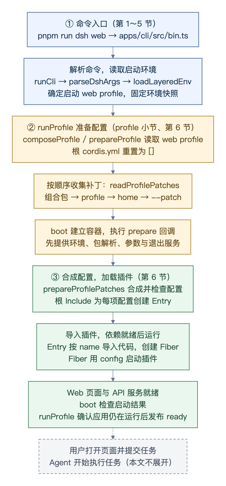
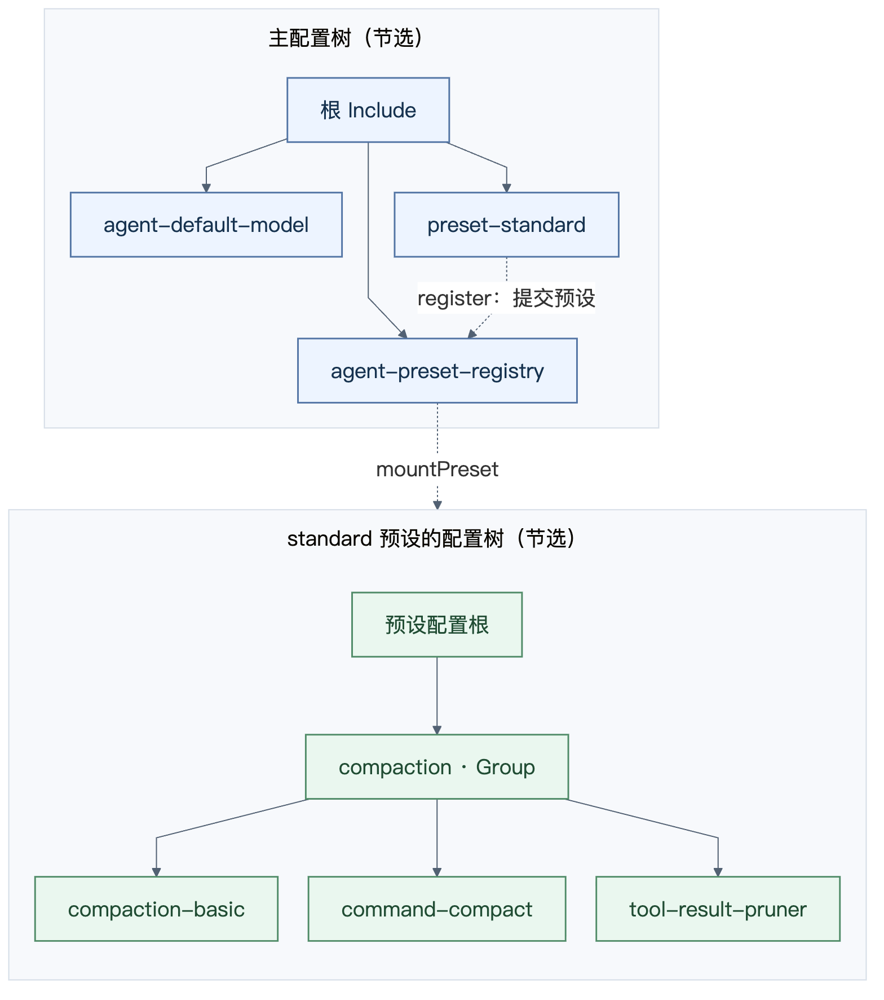

# 源码精读1：启动过程

本文从 `pnpm run dsh web` 开始，研究一个 AI 应用怎样把部署选择变成运行中的组件：谁确定配置，谁提供公共环境，谁管理组件的启动与退出。读完应能为自己的应用划分这些职责。

本章围绕三个设计问题展开：

- 同一套 Agent 能力用于不同应用入口时，哪些差异由配置表达，哪些属于业务代码？
- 配置来自多个组合包和覆盖文件时，怎样确定最终生效值？
- 组件存在依赖且可能启动失败时，谁负责激活与清理？

**配置描述本次应用装配什么；插件实现具体能力。** `runProfile` 准备配置和公共服务，再调用 `boot` 完成加载。插件内部的扩展与作用域机制留到[第 3 篇](dsh-source-reading-outline-20261029.md)讨论，本篇先明确启动层的职责。

## 启动过程总览：从命令到 Web 可用

沿箭头从上往下读：**① 解析命令 → ② 准备配置和容器 → ③ 加载插件**。每一步都保留对应函数名，方便对照源码。



[查看流程图的 Mermaid 源码](figures/dsh-startup-overview.mmd)

这里的箭头表示启动阶段的先后关系；具体插件按服务依赖激活，同级插件可以并发加载。**应用就绪、Agent 已创建、业务任务完成，需要分别判断。** [声明式 Agent](../packages/core/agent-loop/src/index.ts#L392) 可以随插件启动创建；任务怎样执行，由下一篇的 Agent 循环解释。

先确认 profile 与配置职责，再读配置合成和插件加载。命令解析的细节放在第 2 节的折叠区，便于按需对照源码；第 4 节整理可用于自己应用的设计产出。

## 1. 先确定本次应用使用的配置

**profile 是一套有名字的应用启动配置。** 它决定启动哪些插件、给插件传什么参数，以及怎样组织这些插件。执行 `pnpm run dsh web`，就是让 dsh 按名为 `web` 的 profile 启动应用。

每个 profile 保存在一个目录中，加载位置按下面的规则确定：

```text
设置了 DSH_HOME：$DSH_HOME/profiles/<profile 名称>/
未设置 DSH_HOME：~/.dsh/profiles/<profile 名称>/
```

<details>
<summary>本机示例：2026-10-16 核对的 profile 目录</summary>

当时 `DSH_HOME` 未设置，因此实际目录是：

```text
/Users/pangyan/.dsh/profiles/
├── web/
│   ├── package.json
│   ├── cordis.patch.yml
│   └── cordis.yml
└── desktop/
    ├── package.json
    ├── cordis.patch.yml
    └── cordis.yml
```

本机可打开 `/Users/pangyan/.dsh/profiles/web`，查看 `/Users/pangyan/.dsh/profiles/web/package.json` 和 `/Users/pangyan/.dsh/profiles/web/cordis.patch.yml`。

</details>

以启动 `web` 为例，本地文件的用途是：

| 文件 | 加载时用它做什么 |
| --- | --- |
| `web/package.json` | 读取 `dsh.profile.bundles`，确定这个应用使用哪些组合包及其顺序；再找到各组合包提供的配置补丁。 |
| `web/cordis.patch.yml` | 读取这个 profile 自己的修改，在组合包默认配置上增加、修改或禁用插件。 |
| `web/cordis.yml` | 启动器每次将它重置为 `[]`，作为配置加载的根文件；最终插件配置由补丁生成。 |

目录名 `web` 来自命令参数，父目录来自 home 目录解析规则。源码中的 `resolveDshHome()` 确定后者，`resolveProfileDir('web')` 再拼出完整 profile 路径。应用名称与部署位置由启动参数和环境确定，业务插件通过准备好的上下文使用它们。

第 3 节使用本机示例及其组合包中的配置，说明这些输入如何变成插件树。

## 2. 命令怎样抵达启动入口

这条调用链负责把启动意图交给 `runProfile`：`pnpm run dsh web` → `bin.ts` → `runCli()` → `parseDshArgs()` → `runProfile()`。其中的参数解析与 TypeScript 语法可以按需细读。

<details>
<summary>源码细读：命令入口、参数来源与操作分派</summary>

### 2.1 从 pnpm 命令进入 runCli

执行：

```bash
pnpm run dsh web
```

`pnpm` 在根目录的 `package.json` 中找到 `dsh` 脚本：

```json
"dsh": "node --import tsx/esm apps/cli/src/bin.ts"
```

后面的 `web` 会作为参数追加进去，因此实际执行的是：

```bash
node --import tsx/esm apps/cli/src/bin.ts web
```

这里有三件事：

- `node` 启动进程。
- `--import tsx/esm` 预加载 TypeScript 支持，使 Node 能执行这个项目的 `.ts` 入口。
- `apps/cli/src/bin.ts` 是入口文件，`web` 是交给它处理的参数。

Node 加载 `bin.ts` 后，会执行文件顶层的代码。文件底部有：

```typescript
if (import.meta.main) {
  await runCli()
}
```

这一段的目的是区分两种用法：直接执行 `bin.ts` 时，自动调用 `runCli()`；其他文件导入 `runCli` 时，由调用方决定何时调用、传入什么选项。只声明 `runCli` 函数，并不会启动 CLI。

源码：`package.json` 的 `scripts.dsh`；`apps/cli/src/bin.ts` 的文件末尾。

### 2.2 runCli 的 options 从哪里来

`runCli` 有一个默认参数：

```typescript
export async function runCli(options: RunCliOptions = {}): Promise<void> {
  const version = getDshRuntimeVersion()
  const { manageDesktopProfile, ...profileOptions } = options
  const invocation = parseDshArgs(process.argv.slice(2), version, manageDesktopProfile)
  // 根据 invocation.mode 选择后续操作。
}
```

本次文件底部调用的是 `runCli()`，没有传入对象，因此：

```typescript
options = {}
manageDesktopProfile = undefined
profileOptions = {}
```

为什么还要提供 `options`？因为打包后的启动器也可以导入并调用 `runCli`，告诉它使用哪套包管理运行环境，以及是否允许管理桌面应用的 profile。

它的类型是：

```typescript
export type RunCliOptions = Pick<RunProfileOptions, 'packageManager'> & {
  manageDesktopProfile?: boolean
}
```

`Pick` 只保留 `RunProfileOptions` 的 `packageManager` 字段，`&` 再增加 `manageDesktopProfile`。这些字段都是可选的，所以空对象合法。

**`options` 来自函数调用者，命令行里的 `web` 来自 `process.argv`。** 解构将只用于参数解析的桌面管理标志取出，剩下的包管理选项继续交给 profile 启动器。

源码：`apps/cli/src/bin.ts` 的 `RunCliOptions`、`runCli`。

### 2.3 命令行参数解析：从 web 到启动指令

`process.argv` 的前两项是 Node 路径和入口文件路径。去掉它们后，本次待解析的内容是：

```typescript
['web']
```

解析器允许用 profile 名称作为简写，因此把它展开成：

```typescript
['--profile', 'web']
```

本次没有选择插件管理或配置导出，解析结果就是：

```typescript
{
  mode: 'profile',
  profile: 'web',
  fromDefaultProfile: undefined,
  patches: [],
  args: [],
}
```

这个对象在代码里叫 `invocation`，可以直接理解为“解析后的启动指令”：

| 字段 | 本次含义 |
| --- | --- |
| `mode: 'profile'` | 执行启动应用这个操作。 |
| `profile: 'web'` | 使用名为 web 的配置档案。 |
| `fromDefaultProfile: undefined` | 使用现有档案，不要求先从模板重建。 |
| `patches: []` | 没有通过 `--patch` 追加配置修改。 |
| `args: []` | 没有额外参数需要交给应用插件。 |

所以，`web` 是“使用哪份配置”，`mode` 是“对这份配置做什么”。

源码：`apps/cli/src/args.ts` 的 `parseDshArgs`、`resolveBoot`。

### 2.4 switch 如何选择操作分支

`runCli` 根据 `invocation.mode` 分派工作：

| mode | 作用 | 示例命令 |
| --- | --- | --- |
| `profile` | 加载配置，启动插件。 | `pnpm run dsh web` |
| `plugin` | 管理指定 profile 的插件依赖。 | `pnpm run dsh plugin --profile web add <包名>` |
| `dump-config` | 输出 YAML 配置，供查看最终配置。 | `pnpm run dsh web --dump-config` |
| `dump-config-schema` | 输出配置字段和类型说明。 | `pnpm run dsh web --dump-config-schema` |

本次 `mode` 是 `profile`，所以进入启动分支。配置导出与插件管理各有自己的分支，不需要先把整个 Web 应用启动起来。

这里的 `default` 会对未处理的模式报错。正常启动所用的默认模式，已经在参数解析时确定。

源码：`apps/cli/src/bin.ts` 的 `switch (invocation.mode)`。

### 2.5 profile 分支把什么交给 runProfile

启动分支先加载 `profile-boot.ts`，再传入启动所需的数据：

```typescript
const { runProfile } = await import('./profile-boot.ts')

await runProfile({
  environment: loadLayeredEnv('dsh'),
  profile: invocation.profile,
  fromDefaultProfile: invocation.fromDefaultProfile,
  patchFiles: invocation.patches,
  args: invocation.args,
  ...profileOptions,
})
```

其中最容易忽略的是 `environment`。启动器会先读取进程环境和适用的 `.env` 文件，生成一份固定的环境快照，再让插件启动。这样，代理设置和各个插件读取的启动环境来自同一份数据。

到这里，CLI 已经决定“启动 web”，也准备好了参数；**哪些插件属于 web、插件之间如何组织，要进入 `runProfile` 才会处理。**

源码：`apps/cli/src/bin.ts` 的 `case 'profile'`。

</details>

## 3. 配置怎样变成运行中的应用

**它最接近 Spring IoC 容器的装配过程：读取组件定义，确定参数，创建实例，注入依赖，管理销毁。** 下面使用本机 `/Users/pangyan/.dsh/profiles/web/` 的真实配置说明。

### 3.1 加载原则，以及 Java 类比

| DSH 中的概念 | 在这里负责什么 | 最接近的 Spring 概念 |
| --- | --- | --- |
| profile、组合包补丁 | 声明本次应用有哪些插件、使用什么参数。 | 启动配置与 `@Configuration` 模块。 |
| `Entry` | 保存一项插件定义：`id`、`name`、`config` 和父节点。 | `BeanDefinition`。 |
| `name`、模块导入 | 找到并导入插件代码。 | 根据类名加载组件类。 |
| `config`、`inject` | 向实例提供参数，并声明需要的服务。 | 配置绑定、依赖注入。 |
| `Fiber` | 管理这次插件运行、依赖等待和资源清理。 | Bean 实例的生命周期管理；不是单独一个 Spring 类的对应物。 |
| Group 配合 `isolate` | 成组挂载插件，并为指定服务设置独立访问域。 | 子 `ApplicationContext`，职责近似，服务可见性规则不完全相同。 |

抓住三条原则：

- **先合成配置，再运行配置中的插件。** 后面的补丁可以修改前面的定义，不能读到一项就直接按初始参数执行。
- **按服务依赖激活。** 同级插件可以并发加载；YAML 的行顺序不保证执行顺序。
- **按父子归属清理。** 父插件管理自己挂载的孩子，关闭时沿这个关系回收资源。父子树与服务依赖图是两回事。

### 3.2 源码中的加载流程


[查看图的 Mermaid 源码](figures/dsh-plugin-load-flow.mmd)

**第一步：boot 先准备容器环境。** `runProfile` 把补丁和准备回调交给 `boot`。回调先提供环境快照、包解析规则、应用参数和退出入口，保证配置中的插件一开始运行就能使用它们。

[boot 源码](../packages/boot/app-boot/src/index.ts#L1205) 的关键顺序是：

```typescript
await ctx.plugin(Loader)
await prepare?.(ctx)
await mountRootInclude(ctx, absoluteConfigPath, patches, bareModuleBaseUrl, binName)
```

**第二步：合成最终配置，再交给根 Include。** `mountRootInclude` 调用 [prepareProfilePatches](../packages/boot/app-boot/src/compatibility-preflight.ts#L180)：

```typescript
const entries = applyEntryPatches([], patches, patchWarning(ctx))
const rows = prepareProfileEntries(ctx, entries, parentURL, binName)
return rows.length === 0 ? [] : [{ insert: rows }]
```

第一行按顺序应用补丁，第二行检查兼容性，第三行把结果包装成一次插入，交给根 Include。根 Include 读取启动器重置为 `[]` 的 `web/cordis.yml`，应用这次插入，再由 `EntryGroup` 为每项配置创建 `Entry`。

以真实的默认模型配置为例：`dsh-base` 先添加 `agent-default-model`，初始参数为 `deepseek-official / deepseek-flash`。本机 `/Users/pangyan/.dsh/profiles/web/cordis.patch.yml` 随后修改同一个 `id`：

```yaml
- id: agent-default-model
  name: "@deepseek-ai/dsh-agent-default-model"
  config:
    provider: codex-relay
    model: gpt-6-astra
```

因此只产生一个 `agent-default-model` 配置项，最终参数是 `codex-relay / gpt-6-astra`。`id` 用于定位配置项，`name` 用于定位插件代码；补丁中的 `config` 替换整份配置，不做递归合并。

**第三步：Entry 导入代码，Fiber 执行插件。** 真正把配置交给插件运行系统的是 [Entry._init](../vendor/loader/src/config/entry.ts#L223)：

```typescript
moduleNamespace = await this.parent.tree.import(this.options.name, this.getOuterStack)
const plugin = this.loader.unwrapExports(moduleNamespace)
this.fiber = this.ctx.registry.plugin(plugin, this.options.config, this.getOuterStack).ctx.fiber
```

这三行分别完成：按 `name` 导入模块 → 取出插件导出 → 用最终 `config` 创建运行实例。`registry.plugin` 内部创建 `Fiber`；依赖服务可用后，Fiber 才执行插件函数，或创建插件类并执行其初始化逻辑。

本例模块默认导出 `AgentDefaultModelConfig`，实例提供 `agentDefaultModel` 服务。其他组件通过这个服务读取默认模型。对应源码：[插件实现](../packages/core/agent-default-model/src/index.ts)、[创建 Fiber](../vendor/cordis/src/registry.ts#L316)、[执行插件代码](../vendor/cordis/src/fiber.ts#L248)。

### 3.3 为什么会形成树

**因为插件可以继续挂载子插件，而父插件负责管理这些孩子。** 本机 `standard` 预设的压缩分组就是实际例子。

来源：[standard.patch.yml](../packages/bundle/web-app/presets/standard.patch.yml)。下面是 `preset-standard.config.plugins` 中的一项，省略了子插件的具体参数：

```yaml
- id: compaction
  name: cordis:group
  group: true
  isolate:
    compaction: true
    toolResultPruner: true
  config:
    - id: compaction-basic
      name: '@deepseek-ai/dsh-compaction-basic'
    - id: command-compact
      name: '@deepseek-ai/dsh-command-compact'
    - id: tool-result-pruner
      name: '@deepseek-ai/dsh-compaction-tool-result-pruner'
```



图中实线表示配置父子关系，虚线表示调用关系；只展示本节相关节点。[查看 Mermaid 源码](figures/dsh-plugin-tree.mmd)

源码中，这组插件的加载分为两个动作：

1. `preset-standard` 的 [AgentPreset](../packages/preset/agent-preset/src/index.ts) 调用 `agentPresets.register`。注册器在注册时调用 [mountPreset](../packages/preset/agent-preset-registry/src/mount.ts#L204)，为 `plugins` 建立独立的内存配置树。
2. 读到 `compaction` 后，Loader 加载内置 [Group](../vendor/loader/src/config/group.ts#L75)。Group 把 `config` 数组继续当作子插件列表加载：

```typescript
async* [Service.init]() {
  yield () => this.stop()
  await this.update(this.config)
}
```

`update` 加载三个孩子，`stop` 在 Group 释放时清理它们。`isolate` 则让这一组使用自己的 `compaction`、`toolResultPruner` 服务，避免与其他预设的同名服务混用。这就是这个树结构的实际用途：**成组运行、共享指定的服务域、成组清理。**

树不表示服务调用顺序。例如主配置中的 `web-startup` 和 `webserver` 是兄弟节点，`webserver` 仍要等待 `web-startup` 提供 `webStartup` 服务。可以类比 Spring：上下文有父子关系，Bean 之间另外有依赖关系。

## 4. 设计自己的应用时，怎样划分启动职责

下面按本章已看到的机制整理职责。迁移到其他 AI 应用时，应先确定这些职责的归属，再选择是否需要 profile、补丁或插件树。

| 职责 | DSH 的实现依据 | 自己应用需要确定的设计 |
| --- | --- | --- |
| 接收启动意图 | CLI 把命令解析成 `invocation`，交给 `runProfile`。 | 哪些入口复用同一套能力，入口分别提供什么参数。 |
| 确定有效配置 | 组合包和覆盖文件先合成为最终配置，再加载插件。 | 配置来源、覆盖顺序，以及冲突时怎样定位生效值。 |
| 准备公共环境 | `boot` 先执行准备回调，再挂载配置中的插件。 | 环境、依赖解析、应用参数和退出服务何时可用，由谁提供。 |
| 激活与释放组件 | 服务依赖决定激活条件，父子归属决定资源清理关系。 | 依赖图与资源所有权分别怎样表达，启动到一半失败时清理什么。 |
| 接收并执行任务 | Agent 循环接纳输入、调用模型与调度工具。 | 应用就绪、输入已接收、执行中和业务完成分别用什么证据判断。 |

启动清理也属于这份职责划分。[runProfile](../apps/cli/src/profile-boot.ts#L263) 在加载业务插件前保存应用上下文；多个退出来源复用同一次清理 Promise，先释放插件树，再撤销代理，即使前一项释放失败也继续处理后一项。这解决的是启动与退出期间已建立资源的回收。

设计时还要明确：组件资源被释放，不代表已经提交到外部系统的业务操作被撤销。启动成功也不验证每一种模型请求或业务操作都会成功；这些需要执行阶段的检查与结果证据。

多层配置和动态插件组合的收益来自真实的部署差异。只有一个固定入口、依赖基本不变的应用，可以使用更简单的配置与显式装配；先把配置来源、依赖和资源所有权说明白，再决定需要多少组合机制。

## 附：Electron 桌面端从哪里启动

桌面开发入口是 `pnpm run dev:desktop`，已有构建产物时可以用 `pnpm run start:desktop`。它们通过桌面应用的开发脚本启动 Electron。

桌面宿主随后也会调用 `runProfile`，复用配置和插件加载能力。普通 CLI 不允许直接用 `dsh desktop` 启动桌面应用。

## 对照源码时，从这些函数看起

下面的路径均相对于仓库根目录。本机配置示例沿用 2026-10-16 的记录，启动装配与清理相关源码在 2026-10-29 复核；用函数名定位，可避免新增注释后行号变化的影响。

| 想弄清的问题 | 文件与函数 |
| --- | --- |
| 命令怎样进入启动函数？ | `apps/cli/src/bin.ts`：`runCli` 和文件末尾的入口判断。 |
| web 怎样被解释成启动指令？ | `apps/cli/src/args.ts`：`parseDshArgs`、`resolveBoot`。 |
| 本地 profile 目录怎样确定？ | `packages/util/home-paths/src/index.ts`：`resolveDshHome`；`packages/boot/app-boot/src/profile.ts`：`resolveProfileDir`。 |
| 配置和公共服务在哪里准备？ | `apps/cli/src/profile-boot.ts`：`prepareProfile`、`composeProfile`、`runProfile`。 |
| 多层补丁怎样排列？ | `packages/boot/app-boot/src/profile-context.ts`：`readProfilePatches`。 |
| 准备回调与配置加载的先后关系？ | `packages/boot/app-boot/src/index.ts`：`boot`、`mountRootInclude`。 |
| 补丁在哪里变成最终配置？ | `packages/boot/app-boot/src/compatibility-preflight.ts`：`prepareProfilePatches`。 |
| 一项配置在哪里开始加载插件？ | `vendor/loader/src/config/entry.ts`：`Entry._init`。 |
| standard 预设怎样加载自己的插件？ | `packages/preset/agent-preset/src/index.ts` 的 `AgentPreset`；`packages/preset/agent-preset-registry/src/index.ts` 的 `register`、`activate`；同目录 `mount.ts` 的 `mountPreset`。 |
| Group 和 Include 怎样加载子插件？ | `vendor/loader/src/config/group.ts` 的 `Group`；`vendor/include/src/index.ts` 的 `Include`。 |

## 下一章

[源码精读2：一条消息如何驱动 Agent 执行](dsh-agent-loop-20261029.md)，从用户消息入队开始，继续看轮次、模型调用和工具执行。
